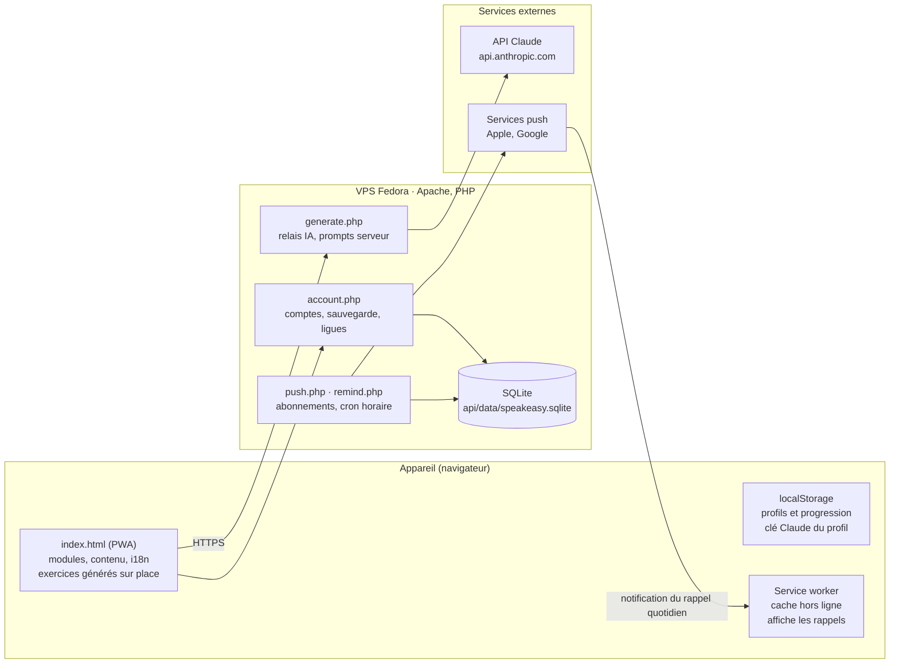

# Speakeasy — Cahier des charges et dossier technique

Version de référence : v34 · 15 novembre 2026 · Naulan

Les sections 1 et 2 décrivent l'application telle qu'elle est en v34. Le détail de chaque version est dans `historique-et-decisions.md`.

Version vivante et commentable : https://claude.ai/artifact/ShUL8ouoWpa4PSS2iN3yFu

## 1. Présentation

Speakeasy est une application web d'apprentissage des langues inspirée de Duolingo, auto-hébergée sur un VPS personnel à l'adresse https://www.naulan-chrzaszcz.fr/speakeasy/. La version de référence est la v31.1 (novembre 2026). Le code est un projet modulaire depuis la v26 ; la direction artistique actuelle (icônes dessinées, chapitres, onglet Quêtes, images) date des v28 à v31.

### Objectifs

- Progresser en anglais pour la conversation de tous les jours, l'anglais professionnel et le TOEIC.
- Couvrir l'orthographe française du Certificat Voltaire et le coréen avec les mêmes règles de jeu.
- Offrir une expérience ludique et addictive : animations, objectifs quotidiens, séries, ligues, sans système de vies.
- Être utilisable en priorité dans Safari sur iPhone, installable en application (PWA), et aussi sur Android et ordinateur.
- Rester ouverte à l'international : interface complète en français, en anglais et en coréen.

### Public

- Utilisatrice principale : la propriétaire du site, sur iPhone.
- Famille, amis et collègues invités : chacun a son profil et sa progression séparée.
- Apprenants anglophones et coréanophones grâce aux interfaces traduites.

### Périmètre des cours

| Cours | Identifiant | Langue enseignée | Unités | Interfaces qui le proposent |
| --- | --- | --- | --- | --- |
| Anglais quotidien | en-daily | anglais (en-US) | 24 | fr, ko |
| Anglais rédaction pro (dont dev logiciel) | en-pro | anglais (en-US) | 20 | fr, ko |
| TOEIC (Parts 1 à 7) | en-toeic | anglais (en-US) | 27 | fr, ko |
| Orthographe Voltaire | fr-volt | français (fr-FR) | 21 | fr, en, ko |
| Coréen (hangul, vie quotidienne, 맞춤법) | ko | coréen (ko-KR) | 30 | fr, en |
| Apprendre le français (FLE) | fr-fle | français (fr-FR) | 20 | en, ko |

Chaque thème du catalogue contient 18 étapes ; depuis la v34, le parcours le présente comme 3 unités de 6 étapes (Découvrir, Construire, Maîtriser), soit 426 unités affichées pour 142 thèmes. La dernière étape du thème est un bilan. Chaque étape existe aussi en version extrême, qui rapporte une couronne. Le détail des 142 unités est dans `catalogue-des-cours.md`.

### Hors périmètre

- Application Android native : abandonnée au profit du site PWA.
- Contenus protégés du TOEIC (ETS) ou de GlobalExam : jamais copiés, tous les exercices sont originaux.
- Paiement ou abonnement : tout est gratuit et illimité.

## 2. Exigences fonctionnelles

L'application doit couvrir les douze fonctions ci-dessous ; toutes sont en place.

### 2.1 Parcours

- Unités courtes façon Duolingo (v34) : chaque thème est affiché comme trois unités de 6 étapes, chacune avec sa bannière « Chapitre N, unité M · phase », sa barre de progression et un bonus de 10 gemmes à la fin. Les compteurs (barre du haut, chapitres) comptent ces unités. La progression enregistrée ne change pas : aucune migration.
- Un parcours par cours, découpé en chapitres puis en unités, du plus facile au plus difficile (A1 à C1). Un chapitre correspond à un niveau du cours ; le parcours affiche un chapitre à la fois, un écran liste les chapitres et un bouton « Continuer » mène au suivant. C'est le design retenu (v29, confirmé en v31.1).
- Parcours hybride : l'ordre est recommandé mais toute unité peut être commencée à tout moment.
- Bannière d'unité « Chapitre N, unité M », guide de l'unité (astuce, phrases clés, mots utiles, mots en images, règles) et étape conseillée. Les unités repliables d'avant la v29 ont été remplacées par les chapitres.
- Test de niveau à l'entrée : 4 paliers de 12 questions (9 bonnes réponses pour passer au suivant), environ 10 minutes. Les chapitres validés au test sont comptés comme terminés dans la progression (v32) et restent rejouables.
- Version extrême de chaque étape, récompensée par une couronne.
- Pas de système de vies : usage illimité.

### 2.2 Types d'exercices

| Type | Identifiant | Ce que fait l'apprenant |
| --- | --- | --- |
| Choix multiple | mc, mcw, choice | Choisit la bonne traduction, le bon mot ou la bonne règle |
| Images | pic, picw | Choisit la bonne image pour un mot, ou le bon mot pour une image (anglais quotidien, FLE, coréen) |
| Mot manquant | fill | Écrit le mot qui manque dans une phrase générée (notions de grammaire) |
| Tuiles | tiles, tilesRev | Reconstruit la phrase traduite avec des tuiles de mots |
| Saisie | type | Tape la traduction |
| Paires | match | Associe 5 paires mot/traduction |
| Construction | build | Assemble un mot ou une phrase à partir de morceaux |
| Écoute | listen, listenTiles, hear | Écrit ou reconstruit ce qu'il entend |
| Dictée | dictee | Écrit la phrase exacte (Voltaire et coréen : strict) |
| Prononciation | speak | Lit à voix haute, le micro évalue (seuil 0,65) |
| Clique sur la faute | spot | Repère le mot fautif ou valide la phrase (méthode Voltaire) |
| TOEIC | photo, part2, conv, read, readw | Parts 1 à 7 : scène dessinée ou photo, question-réponse, conversation, lecture |
| Hangul | jamo, jamoRev, hg | Reconnaît les lettres, les sons et les syllabes |
| Rédaction | write | Écrit un texte libre, corrigé par l'IA (ou transcription) |

- Après chaque réponse, juste ou fausse, la synthèse vocale lit la phrase correcte.
- Les mauvaises propositions doivent être plausibles (même catégorie, forme proche), jamais devinables.
- Les notes entre parenthèses comme « (formal) » ne font jamais partie des réponses à reconstituer.

### 2.3 Entraînement

- Notions de grammaire (phrases générées par gabarits) et vocabulaire en images.
- Mots utiles par thème (conversation, rédaction pro, TOEIC), écoute TOEIC, lecture Part 7, TOEIC blanc express de 20 questions avec score estimé sur 990.
- Prononciation, dictée, clique sur la faute, sprint de grammaire, sprint de 60 secondes.
- Mes mots, mes mots à retenir (répétition espacée à 1, 3, 7, 14 et 30 jours), mes erreurs (ancrage).
- Réviser une unité au choix, entraînement à thème libre, révision IA illimitée.
- Coréen : alphabet, sons proches (가 / 카 / 까), composition de syllabes, tableau du hangul.

### 2.4 Histoires

- Histoires interactives avec questions de compréhension : 34 en anglais, 12 Voltaire, 14 en coréen, 10 en FLE.
- Histoires supplémentaires générées par l'IA quand une clé est disponible.

### 2.5 Motivation

- XP (10 par bonne réponse ; une leçon compte 11 exercices depuis la v33, soit 110 à 135 XP) et objectif quotidien réglable à 50, 100, 200 ou 400 XP (v32 ; les anciens objectifs 10/20/30/50 sont convertis). Série de jours avec gel de série et paliers récompensés (7, 14, 30 et 50 jours), badges, combo.
- Onglet Quêtes : 3 quêtes du jour tirées chaque matin parmi 14 (une de volume, deux parmi précision, écoute et oral, découverte, révision), avec coffres ; quête du mois de 60 points, paliers à 10, 25, 40 et 60 points (+20, +30, +50 et +100 gemmes) (v32).
- Séances courtes façon Duolingo (v33) : 10 exercices et 1 révision par leçon (12 et 2 pour le bilan d'unité, 12 en version extrême), au lieu de 14 et 2 ; les types d'exercice les plus répétés sont retirés en premier.
- Repères de thème le long de chaque unité (v33) : Découvrir, Comprendre, Construire, Maîtriser, Bilan, avec ce qu'on y travaille (libellés propres au TOEIC, à Voltaire et au hangul).
- « À savoir » après chaque réponse, juste ou fausse (v33) : la règle de l'exercice, sinon les repères de grammaire reconnus dans la phrase (temps, auxiliaires, particules coréennes, négation…), les mots clés de la phrase et, à défaut, l'astuce de l'unité. Avec une IA configurée, le bouton « Explique ma réponse » demande une explication de la phrase et de sa construction (mode `explain`).
- « Trouve l'erreur » (v33) : une fois sur deux, 2 ou 3 phrases à la suite avec de 0 à 3 fautes à toucher ; l'examen blanc Voltaire reste à une phrase.
- Leçon bilan (v33) : carte d'entraînement qui couvre tout ce qui a été vu (unités où l'on se trompe le plus, échantillon du reste du parcours, erreurs à ancrer, mots à revoir), par IA ou en mélange local.
- Fin de séance (v32) : un seul écran de bilan (encouragement, XP, précision, temps, toutes les récompenses gagnées sur la même page : badges, niveau, objectif, quête du mois), puis le rappel de la journée (objectif, quêtes, révisions à faire avec un bouton « Réviser ») ; l'écran de série suit, avec la flamme animée et les jours cochés un à un.
- Barre du haut (v32) : sur téléphone, plus de logo ni d'avatar ; le changement de profil se fait dans l'onglet Profil.
- Gemmes : +5 par leçon, +20 par bilan d'unité, +3 par entraînement, plus les quêtes.
- Boutique : gel de série (50 gemmes, 2 au maximum), double XP 15 minutes (40 gemmes), tenues pour la mascotte Horang. Elle s'ouvre en touchant les gemmes de la barre du haut : son onglet a laissé la place à l'onglet Quêtes (v29, choix conservé).
- Mascotte Horang (un tigre) qui réagit et porte les tenues achetées.

### 2.6 Ligues

- Six ligues hebdomadaires selon l'XP de la semaine : Bronze (0), Argent (300), Or (800), Saphir (1 500), Rubis (2 500), Diamant (4 000) (seuils relevés en v32). Le classement de la semaine liste tous les comptes en ligne : ceux qui n'ont pas encore joué sont à 0 XP, en bas.
- Classement de tous les membres du site stocké sur le serveur : cette semaine et depuis toujours.
- Podium de la semaine passée affiché une fois, avec 50, 30 et 20 gemmes pour les trois premiers.
- Profils locaux du même appareil classés entre eux.

### 2.7 Profils et comptes

- Plusieurs profils par appareil, chacun avec emoji, couleur, code PIN facultatif et progression séparée.
- Compte en ligne facultatif (pseudo + mot de passe) : synchronisation entre appareils, ligue, rappels.
- Un profil local peut passer en ligne sans perdre sa progression (« Passer en ligne »).
- Export et import de la progression, suppression du compte.

### 2.8 Audio et micro

- Synthèse vocale du navigateur, voix choisie par langue ; en phrase mixte, chaque partie est lue dans sa langue.
- Couper le micro ou le son pendant 15 minutes : les exercices concernés sont convertis ou retirés.
- Bouton pour passer un exercice d'écoute ou de prononciation.
- Si la reconnaissance vocale manque (app iPhone) ou ne répond pas en 5 s : bascule sur la dictée du clavier.

### 2.9 Rappels et vibrations

- Rappel quotidien à l'heure choisie par notification push (comptes en ligne, app installée sur iPhone).
- Vibrations sur Android ; retour haptique sur iPhone (iOS 18 ou plus).

### 2.10 Intelligence artificielle

- Chaque profil peut saisir sa propre clé API Claude dans Paramètres › Mon Claude ; elle est stockée sur l'appareil seulement.
- Usages : exercices générés, entraînement à thème, histoires, correction de rédaction, unités générées.
- Modèles : Haiku par défaut, Sonnet ou Opus au choix.
- Sans clé : repli local (révisions tirées des unités les plus proches du thème).
- L'IA reçoit les règles de grammaire les moins réussies de l'élève ; chaque séance IA ou locale ajoute des phrases sur ces règles.
- Une unité créée par l'IA arrive dans le dernier chapitre ; l'IA reçoit les titres de toutes les unités existantes pour ne pas reprendre un thème.
- L'IA ne produit pas d'images : les exercices en images utilisent les dessins intégrés à l'application.

### 2.11 Interfaces et langues

- Interface en français, anglais ou coréen, choisie au premier lancement et modifiable dans Paramètres › Préférences.
- Les explications des cours sont traduites dans la langue de l'interface, y compris les prompts envoyés à l'IA.

### 2.12 Apparence et hors ligne

- Thème clair, sombre ou automatique.
- Fonctionnement hors ligne après la première visite, sauf comptes, ligue et IA.
- Raccourcis clavier : Entrée pour vérifier puis continuer, 1 à 4 pour choisir une réponse.

## 3. Exigences non fonctionnelles

La cible prioritaire est Safari sur iPhone en mode application installée ; tout le reste en découle.

| Domaine | Exigence | Comment c'est vérifié |
| --- | --- | --- |
| Mobile | Lisible et utilisable de 320 à 430 px de large, encoche et barre du bas respectées (safe-area), hauteur en 100dvh | Tests de mise en page sur iPhone SE, iPhone 15 Pro Max, Pixel 7, Android 360 px |
| Mobile | Champs en 16 px minimum (sinon l'iPhone zoome), cibles tactiles d'au moins 38 à 44 px | Audit automatique des tailles |
| PWA | Installable (manifest, icônes, apple-touch-icon), plein écran, hors ligne via service worker | Contrôle du cache et du mode hors ligne |
| Accessibilité | Contraste du texte d'au moins 4,5, libellés sur les boutons icônes, messages annoncés (aria-live) | Audit de contraste en clair et en sombre |
| Typographie | Espace insécable avant « : ; ! ? » et dans les guillemets français | Automatique dans l'app |
| Performance | Un seul fichier HTML d'environ 1,2 Mo, 420 Ko compressé ; aucune dépendance externe à l'exécution | Mesure de taille à chaque build |
| Sécurité | Clé Claude jamais dans index.html ni synchronisée ; prompts construits côté serveur ; base, sources et installateur inaccessibles depuis le web | Tests de sécurité de l'API |
| Sécurité | En-têtes CSP, X-Frame-Options, HSTS, nosniff ; limite de tentatives de connexion et de générations par heure | Contrôle des en-têtes sur le site en ligne |
| Vie privée (RGPD) | Polices hébergées sur le serveur, aucun traceur, aucun cookie, mot de passe haché | Revue du réseau dans le navigateur |
| Hébergement | PHP 8 et SQLite sur Apache, Fedora avec SELinux, aucun service externe obligatoire | Installateur et vérifications finales |
| Robustesse | Aucune erreur JavaScript, aucun exercice bloquant, sauvegarde locale même sans réseau | Suites de tests automatiques |

Contraintes de contenu : exercices originaux uniquement, pas de questions trop simples, difficulté croissante, validation tolérante (voir section 7).

## 4. Architecture technique

Le code est un projet Node en modules ES, construit par esbuild en un seul fichier index.html. Le serveur ne sert que des fichiers statiques et quatre scripts PHP. Le détail des modules est dans `architecture.md`.

Le navigateur génère et corrige les exercices sans réseau ; le serveur n'intervient que pour les comptes, la ligue, l'IA et les rappels.

### 4.1 Organisation du projet

| Dossier | Contenu |
| --- | --- |
| src/content/ | Contenu des cours en JSON (un fichier par cours, histoires, sections) ; `index.js` l'adapte à la langue d'interface |
| src/i18n/ | Langue d'interface, traduction du DOM, dictionnaires `en.json` et `ko.json` |
| src/core/ | État `S` du profil, migrations, progression, profils locaux, XP, outils |
| src/exercises/ | Génération (`make`), mauvaises réponses, correction, affichage par type (`R[type]`), hangul (TypeScript) |
| src/lesson/ | Construction et déroulé des leçons, rédactions, clavier |
| src/features/ | Test de niveau, quêtes et badges, mots à retenir, thèmes, unités IA, coach |
| src/screens/ | Un module par écran : parcours et chapitres, entraînement, histoires, ligue, quêtes, boutique, profil, paramètres, série, stats, comptes |
| src/services/ | Comptes en ligne, IA, rappels, voix et micro |
| src/ui/ | Composants, routeur, plateforme (iOS/Android, thème), mascotte et scènes de Horang, icônes dessinées, images de vocabulaire et scènes de la Part 1 (`pics/`), bouton retour, typographie |
| src/main.js, globals.js, types.ts | Démarrage, API globale sur window, types du modèle de données |
| public/ | Service worker, manifest, icônes, polices |
| server/ | API PHP (account, generate, push, remind), installateur Fedora, LISEZ-MOI |
| scripts/ | Build esbuild, thème sombre, zip de production, serveur local |
| tests/ | Tests Playwright et lanceur `run.mjs` |

### 4.2 Principes

- Commandes :
  - `npm run build` produit dist/ ;
  - `npm run check` vérifie le build et TypeScript ;
  - `npm test` et `npm run test:all` lancent les tests ;
  - `npm run zip` fabrique le paquet de production.
- Code : modules ES en JavaScript ; le nouveau code peut être écrit en TypeScript (`src/exercises/hangul.ts` sert d'exemple). Le code est mis en forme par Prettier.
- État :
  - un objet `S` par profil (`core/accounts.js`), sauvegardé dans localStorage (`speakeasy-v1:<id>`) ;
  - la leçon en cours est `L` (`lesson/engine.js`) ;
  - pour les remplacer : `set_S()` et `set_L()`.
- Rendu : HTML généré par chaînes de gabarits, routage par le hash de l'URL (#parcours, #entrainement, #histoires, #ligue, #boutique, #profil, #stats).
- Exercices : générés à la volée par `make(type, ctx)` à partir des données d'unité ; une leçon = `buildLesson(cours, unité, étape)`.
- Traduction :
  - le code est écrit en français ;
  - `i18n/translate.js` traduit le DOM (observateur de mutations) avec les dictionnaires ;
  - `content/index.js` traduit le contenu des cours au chargement.
- Thème sombre : généré au build à partir des couleurs du thème clair (`scripts/darkgen.mjs`), suit le système ou le choix enregistré dans `speakeasy-theme`.
- Service worker :
  - réseau d'abord pour la page, avec retour au cache après 3,5 s ;
  - cache d'abord pour les polices ;
  - le nom du cache (`speakeasy-v26-<empreinte>`) est calculé à chaque build.

## 5. Données et API

La progression vit d'abord sur l'appareil ; un compte en ligne en garde une copie complète sur le serveur (600 Ko maximum par compte).

### 5.1 Stockage sur l'appareil

| Clé localStorage | Contenu |
| --- | --- |
| speakeasy-accounts | Liste des profils (id, nom, emoji, couleur, PIN) et profil courant |
| speakeasy-v1:&lt;id&gt; | État S du profil (détail ci-dessous) |
| speakeasy-ui | Langue d'interface : fr, en ou ko |
| speakeasy-theme | Thème forcé : clair ou sombre (absent = automatique) |
| speakeasy-micko | Le micro ne fonctionne pas sur cet appareil : dictée du clavier |

Principaux champs de l'état S :

- Progression : `dn` (étapes faites par cours et par unité, masque de 18 bits), `ext` (couronnes), `place` (résultat du test de niveau), `sec` et `track` (cours courant).
- Gamification : `xp`, `gems`, `streak`, `lastDay`, `goal`, `week`, `freeze`, `boostUntil`, `badges`, `bestCombo`, `owned` et `wear` (tenues).
- Révision : `bank` (mots à retenir, boîtes de répétition), `mist` (erreurs), `elog`, `coach`.
- Records : `sprint`, `mockBest`, `voltBest`, `koBest`, `stories`.
- Réglages : `set` (voix, vitesse, micro, son, clé et modèle Claude, rappel), `speakOff` et `listenOff` (pauses de 15 minutes), `pv` (version des données).
- Synchronisation : `ts` (date de dernière modification) ; le compte en ligne ajoute `srv`, `token` et `name` dans la liste des profils.

### 5.2 Base SQLite (serveur)

| Table | Colonnes | Usage |
| --- | --- | --- |
| users | id, name (unique, insensible à la casse), pass (haché), emoji, color, state, ts, wxp, week, xp, streak, seen, created | Comptes et dernière sauvegarde |
| tokens | hash, uid, created | Jetons de session, stockés hachés (SHA-256) |
| attempts | ip, ts | Limite des tentatives de connexion par IP |
| history | uid, week, wxp | XP de chaque semaine passée |
| podiums | week, uid, rank, wxp | Podium figé de chaque semaine |
| settled | week | Semaines dont les récompenses sont attribuées |
| subs | endpoint, uid, hour, tz, last_day, created | Abonnements aux rappels |

Les clés VAPID des notifications sont créées automatiquement dans `api/data/vapid.json`.

### 5.3 Points d'entrée de l'API

| Requête | Action | Authentification |
| --- | --- | --- |
| GET account.php?a=ping | Vérifie que l'API répond | Aucune |
| POST account.php?a=register | Crée un compte (pseudo, mot de passe de 6 caractères minimum, emoji, couleur) | Limite par IP |
| POST account.php?a=login | Connexion, renvoie un jeton de 64 caractères | Limite par IP |
| POST account.php?a=load | Renvoie l'état sauvegardé | Jeton |
| POST account.php?a=save | Enregistre l'état, l'XP de la semaine et la série ; archive la semaine précédente | Jeton |
| POST account.php?a=board | Classement : semaine, depuis toujours, podium passé, rang de l'utilisateur | Jeton |
| POST account.php?a=logout, delete | Déconnexion, suppression du compte | Jeton (et mot de passe pour supprimer) |
| GET generate.php | Indique si une clé commune existe | Aucune |
| POST generate.php | Génération IA ; mode parmi exercise, word, write, unit, story, explain ; tout autre mode refusé (400) | Clé du profil en en-tête X-User-Key, ou clé commune ; 30 par heure et par IP |
| GET push.php?a=key | Clé publique VAPID | Aucune |
| POST push.php?a=subscribe, unsubscribe | Abonnement au rappel (heure, fuseau) | Jeton |
| php remind.php (cron) | Envoie les rappels de l'heure à ceux qui n'ont pas encore joué | Ligne de commande uniquement |

La clé commune facultative se règle par la variable d'environnement ANTHROPIC_API_KEY. La clé d'un profil n'est jamais enregistrée sur le serveur ni synchronisée.

## 6. Déploiement et exploitation

Un seul script, installer-fedora.sh, installe ou met à jour le serveur ; il se relance sans risque à chaque version.

### 6.1 Contenu du paquet de production

`npm run zip` produit `release/speakeasy-production.zip`. Il contient index.html (minifié), sw.js, manifest.webmanifest, icons/, fonts/fonts.css, les quatre fichiers PHP de api/, api/data/.htaccess, LISEZ-MOI.txt et installer-fedora.sh. Aucun fichier source n'est publié.

### 6.2 Ce que fait l'installateur

1. Installe les paquets : httpd, mod_ssl, PHP avec PDO SQLite, OpenSSL, certbot, augeas.
2. Fixe les droits : fichiers lisibles par Apache, api/data/ écrivable par Apache seulement.
3. Télécharge les polices Nunito et Noto Sans KR dans fonts/ (repli Google Fonts en cas d'échec).
4. Configure SELinux : contexte en écriture pour api/data/, autorisation réseau pour PHP (httpd_can_network_connect).
5. Écrit /etc/httpd/conf.d/speakeasy.conf : accès refusé à api/data et aux fichiers sources, compression, en-têtes de sécurité (CSP, X-Frame-Options, nosniff), pas de cache sur sw.js, index.html et fonts.css.
6. Crée un certificat local si mod_ssl n'en a pas, ouvre le pare-feu (http, https).
7. Obtient le certificat Let's Encrypt avec certbot ; si le plugin Apache échoue, passe en mode webroot avec un virtual host 443, la redirection HTTP vers HTTPS et HSTS.
8. Renseigne l'adresse de contact VAPID dans remind.php.
9. Installe la tâche planifiée /etc/cron.d/speakeasy : remind.php à la minute 7 de chaque heure, sous l'utilisateur apache.
10. Vérifie : ping de l'API, compression, icônes, base protégée, dossier api/data écrivable.

### 6.3 Mettre à jour

1. `npm run check`, puis `npm run test:all` : tous les tests doivent réussir.
2. `npm run zip` : le nom du cache du service worker change tout seul, les téléphones récupèrent la nouvelle version.
3. Remplacer les fichiers dans /var/www/html/speakeasy/ sans toucher à api/data/.
4. Relancer `sudo EMAIL=<adresse> bash /var/www/html/speakeasy/installer-fedora.sh` une fois après le passage à la v32 : l'adresse des rappels est alors rangée dans `api/data/config.php`, que les mises à jour suivantes n'écrasent plus. Ensuite, seulement si la configuration serveur a changé.
5. Sur le téléphone : fermer puis rouvrir l'app.

### 6.4 Exploitation

- Sauvegarde à prévoir : copier api/data/speakeasy.sqlite et api/data/vapid.json (perdre vapid.json oblige tout le monde à se réabonner aux rappels).
- Clé IA commune facultative : variable ANTHROPIC_API_KEY dans la configuration d'Apache ou de PHP-FPM.
- Le domaine doit pointer directement sur le VPS : une redirection masquée (cadre OVH) casse l'affichage mobile et le service worker.

## 7. Qualité, règles et pièges connus

Chaque version passe une batterie de tests automatiques avec Playwright (Chromium) et un serveur PHP local, lancée par `npm test` (rapide) ou `npm run test:all` (complète). La v34 les passe tous. Le HTML de la v26 était identique à celui de la v25 sur 430 écrans et leçons comparés.

### 7.1 Tests automatiques

| Test | Ce qu'il vérifie |
| --- | --- |
| Intégrité des données | Génère environ 91 000 exercices dans les 3 interfaces et signale doublons, options vides, réponses absentes |
| Parcours joués | Joue 3 leçons sur chaque groupe de 3 unités de chaque cours en répondant juste ; aucun blocage, aucune bonne réponse refusée |
| Modes | Chaque carte d'entraînement, test de niveau, version extrême, toutes les histoires, boutique, export et import |
| Mise en page | Débordements, tailles de texte et contraste à 320 px (clair) et 390 px (sombre) |
| Émulation mobile | iPhone en app installée (sans vibration ni reconnaissance vocale), iPhone dans Safari (sans notifications), Android |
| Serveur | Inscription, connexion, deux appareils, conflit de semaine, hors ligne, suppression |
| Sécurité | Accès refusés, jetons invalides, limites de tentatives, mode IA inconnu refusé, clé jamais exposée |
| Audio et micro | Pause micro ou son, bouton « Plus tard », micro absent ou muet, retour sur la dictée du clavier |
| Rappels | Passage en ligne, abonnement, exécution de remind.php |
| Bouton retour | Navigation, fermeture des leçons et modales sans quitter le site |
| Textes non traduits | Parcourt tous les écrans en anglais et en coréen et échoue si un texte d'interface est resté en français (réparé en v31.1 : il ne voyait plus rien). Depuis la v32, `i18n_flows` contrôle aussi les 14 quêtes, les écrans de fin de séance, « Mes mots », l'accueil et le test de niveau |

### 7.2 Règles de validation des réponses

- Tolérance par défaut : majuscules, ponctuation et espaces ignorés, nombres en lettres ou en chiffres (anglais et français), articles facultatifs, petite marge de fautes de frappe selon la longueur.
- Accents tolérés en FLE (signalés sans pénalité).
- Mode strict seulement pour les dictées Voltaire et l'orthographe coréenne : c'est l'objet même de l'exercice.
- Prononciation : réussie à partir de 65 % de ressemblance.
- Choix multiples : distracteurs choisis par ressemblance (simScore), jamais quasi identiques à la bonne réponse (tooClose), jamais la réponse sous une autre forme.

### 7.3 Pièges déjà rencontrés

| Problème | Cause | Règle retenue |
| --- | --- | --- |
| Interface trop petite sur iPhone et Android | Domaine redirigé par un cadre OVH | Le DNS pointe directement sur le VPS ; X-Frame-Options SAMEORIGIN |
| Couleurs étranges en mode sombre | Variables du thème clair plus prioritaires | Thème sombre généré par darkgen.py, sélecteurs sans :where |
| « (formal) » exigé dans les tuiles | Note incluse dans la réponse | noNote() retire les notes avant de construire l'exercice |
| « Plus tard » plante (pas de son) | Exercice d'écoute converti comme un exercice de micro | Conversion distincte pour le micro et le son |
| Question triviale « test → Test » | Mot identique dans les deux langues | Ces mots ne donnent ni choix multiple ni saisie |
| Bouton retour qui quitte le site | history.back() appelé à la fermeture | Garde d'historique sans back(), contrôle de location.href |
| Micro bloqué sur « J'écoute… » dans l'app iPhone | Reconnaissance vocale absente en mode installé | Dictée du clavier directement, délai de 5 s ailleurs |
| Rappels impossibles | Profil local, et iOS exige un geste pour la permission | « Passer en ligne » puis bouton « Activer » |
| Pas de vibration sur iPhone | navigator.vibrate absent sur iOS | Astuce de l'interrupteur caché (iOS 18 ou plus) |
| Erreur 403 sur l'API | SELinux et droits du dossier | Contextes SELinux posés par l'installateur |
| certbot échoue (Augeas) | Plugin Apache sans Augeas | Repli webroot automatique |
| Message vocal qui cachait l'exercice | Toast trop étroit et répété | Toast pleine largeur, un seul affichage |
| Zoom de l'iPhone dans les champs | Texte des champs sous 16 px | 16 px minimum |
| Titres restés en français en coréen | Chaînes absentes des dictionnaires | Test automatique des cartes non traduites |

### 7.4 Contraintes à respecter dans toute évolution

- Ne jamais placer de clé API dans index.html ni la synchroniser ; les prompts restent construits côté serveur.
- Ne pas copier de contenus TOEIC ou GlobalExam protégés.
- Toute chaîne d'interface ajoutée doit être traduite en anglais et en coréen.
- Passer `npm run check` et `npm run test:all` avant chaque mise en ligne.

## 8. Feuille de route

Le découpage en modules est fait (v26) ; les prochaines étapes rendent les ajouts encore plus sûrs, par ordre d'intérêt.

1. **Un dossier par type d'exercice.** Réunir génération, affichage, réglages audio et réponse automatique des tests (`make`, `render`, `solve`) : un nouveau type ne toucherait plus qu'un fichier.
2. **Traductions par clés.** Remplacer la traduction du DOM à la volée par des clés `t('cle')` : plus de texte oublié en français, vérification automatique au build.
3. **Sauvegarder la base chaque nuit.** Une ligne dans la tâche planifiée qui copie speakeasy.sqlite et vapid.json, avec 14 jours de rotation.
4. **Charger les cours à la demande.** Ne télécharger que le cours et la langue d'interface utilisés : premier chargement divisé par 3 environ.
5. **Tester sur de vrais iPhone et Android.** Voix, dictée, notifications et retour haptique ne sont pas reproduits par l'émulation.
6. **Récupérer un compte.** Aucune réinitialisation de mot de passe aujourd'hui : prévoir un code de secours affiché à l'inscription.
7. **Enrichir le contenu.** Plus d'unités dans les chapitres courts (chapitre 4 de coréen : 3 unités ; chapitre 1 d'anglais pro et de TOEIC : 2 unités), d'histoires et de questions TOEIC Part 7 ; audio enregistré en option pour les voix absentes du téléphone.
8. **Tableau de bord.** Statistiques de progression par compétence et prédiction du score TOEIC dans le temps.
9. **Clé IA commune avec quotas par compte.** Permettre aux invités sans clé d'utiliser l'IA dans une limite quotidienne.
10. **Passer progressivement en TypeScript.** Convertir les modules au fil des modifications, en commençant par `core/` et `exercises/`.

## 9. Travailler avec Claude

Le projet Claude doit contenir les documents de `docs/`, le fichier `CLAUDE.md` et le code de `src/` ; Claude peut alors faire évoluer l'app sans réexplications.

### 9.1 Ce qu'il faut mettre dans le projet Claude

| Élément | À mettre dans le projet Claude |
| --- | --- |
| CLAUDE.md | Oui : à coller aussi dans les instructions du projet |
| docs/ | Oui, tous les fichiers |
| src/ (sauf content/courses et i18n/*.json) | Oui |
| src/content/courses/*.json, src/i18n/en.json, src/i18n/ko.json | À joindre au besoin (volumineux) |
| server/, scripts/, tests/ | À joindre au besoin |

Le plus simple : mettre le projet dans un dépôt GitHub et le connecter au projet Claude.

### 9.2 Méthode

1. Décrire le besoin en une phrase, avec une capture d'écran si c'est visuel.
2. Demander à Claude de suivre `docs/guide-evolution.md` et de lister les fichiers touchés avant de coder.
3. Exiger `npm run check` et `npm run test:all` réussis, puis `npm run zip`.
4. Pour un gros chantier (sections 8.1 et 8.2) : demander d'abord un plan, sans coder, puis avancer par étapes, avec les tests après chaque étape.
